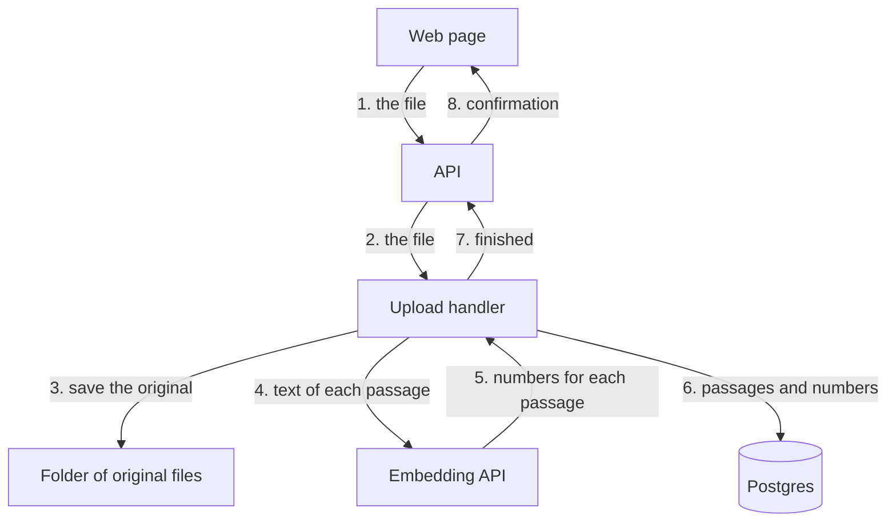
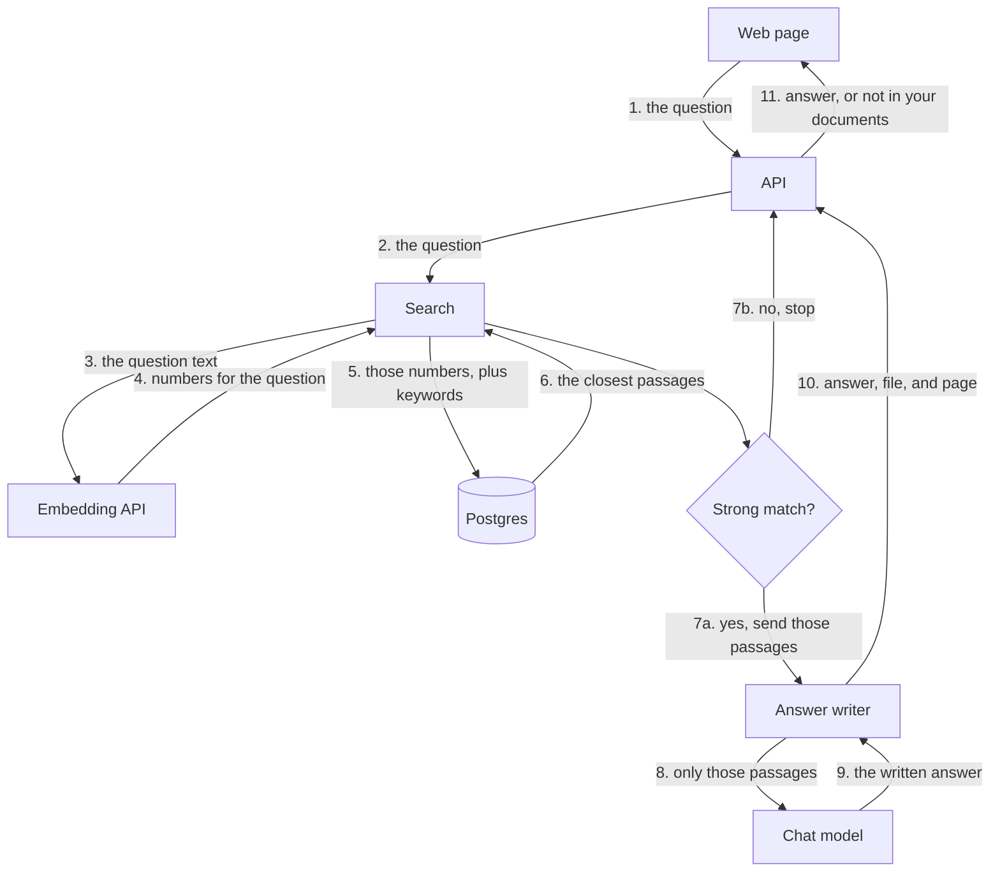
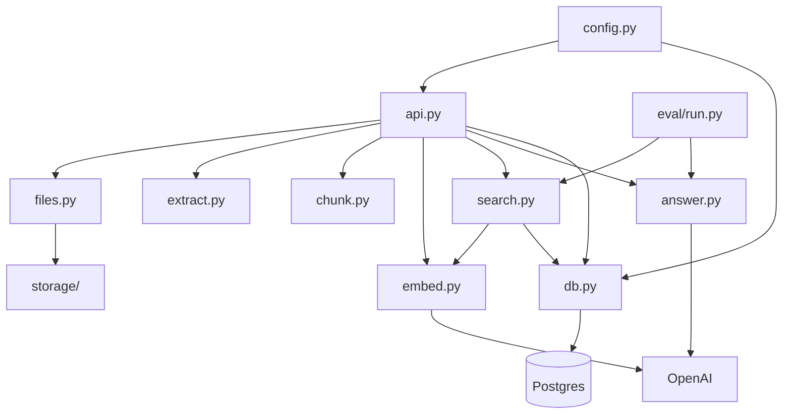
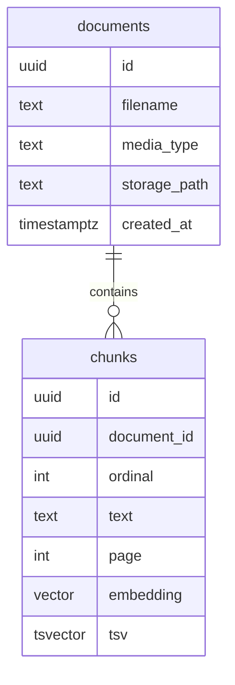

# knowledgehub-ai-server

The backend that powers KnowledgeHub AI.

## High-level design

An upload saves the original file, extracts passages, embeds them, and stores the passages in Postgres. A question searches those passages and either returns a cited answer or refuses.

### Upload

### Question

## Low-level design

### Modules

`config.py` and `db.py` read settings and create the tables. `upload.py` runs the upload steps. `search.py` and `answer.py` run the question steps. `api.py` only handles HTTP.

### Tables

Deleting a document deletes its passages. The original PDF or DOCX stays in `storage/`, not in these tables.
